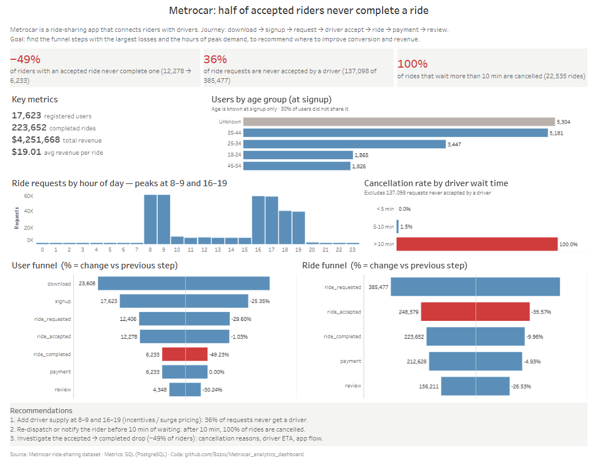

# Metrocar: Ride-Sharing Funnel Analysis

**SQL (PostgreSQL) · Tableau Public · Funnel & operations analytics**

🔗 **[Interactive dashboard on Tableau Public](https://public.tableau.com/app/profile/anastasiia.bzhelenko/viz/Project_metrocar/MetrocarDashboard)**



---

## Business context

Metrocar is a ride-sharing app (similar to Uber or Lyft) that connects riders with drivers.
A rider goes through these steps:

`app download → signup → ride request → driver acceptance → ride completed → payment → review`

## Goal of the analysis

Find **where Metrocar loses users and rides in the funnel** and **when demand peaks**, then recommend where to improve conversion and revenue.

### Business questions

1. Which funnel steps lose the most users and rides?
2. Why are rides not completed? Is it driver supply or rider behavior?
3. When is demand highest during the day?
4. Do platform (iOS / Android / web), age group or day of week change the outcome?

---

## Key findings

| # | Finding | Evidence |
|---|---------|----------|
| 1 | **Half of riders with an accepted ride never complete one** | User funnel: 12,278 accepted → 6,233 completed (−49.2%), the largest drop |
| 2 | **36% of ride requests never get a driver** | Ride funnel: 385,477 requested → 248,379 accepted (137,098 not accepted) |
| 3 | **Waiting more than 10 minutes means the ride is lost** | Cancellation rate by wait time: < 5 min: 0%, 5–10 min: 1.5%, > 10 min: **100%** (22,535 rides) |
| 4 | **Demand is concentrated in commute hours** | 8–9 and 16–19 account for 82% of all ride requests |
| 5 | Platform and weekday make no difference | Completion is about 50% on iOS, Android and web; cancellation is about 42% every day of the week |

**Headline numbers:** 23,608 downloads · 17,623 registered users · 223,652 completed rides · $4.25M revenue · $19.01 average revenue per ride · 26.4% download → completed ride.

## Recommendations

1. **Add driver supply at 8–9 and 16–19** (driver incentives or surge pricing). 36% of requests never get a driver, and almost all demand falls in these hours.
2. **Re-dispatch or notify the rider before 10 minutes of waiting.** After 10 minutes, 100% of rides are cancelled.
3. **Investigate the accepted → completed drop (−49% of riders):** cancellation reasons, driver ETA, app flow.

---

## Dashboard

| Section | What it shows |
|---------|---------------|
| Insight cards | The three main problems in one line each |
| Key metrics | Users, completed rides, revenue, average revenue per ride |
| Users by age group | Age at signup (30% of users did not share their age) |
| Ride requests by hour | Daily demand curve with commute peaks |
| Cancellation by wait time | How the cancellation rate jumps after 10 minutes |
| User and ride funnels | Step-by-step volume and % change vs the previous step; the largest drop is highlighted |

## Method

1. **PostgreSQL (via DBeaver):** queried the raw Metrocar tables and built aggregated result tables: funnels, hourly demand, wait-time cancellation, platform, age and weekday breakdowns.
2. **Export:** each query result was saved as a table (see [`data/`](data)).
3. **Tableau Public:** combined the tables into one data source and built the dashboard (funnels with table calculations for step-to-step change).

## Repository structure

```
├── README.md
├── sql/                    # PostgreSQL queries, one per analysis
│   ├── 01_general_info.sql
│   ├── 02_user_funnel.sql
│   ├── 03_ride_funnel.sql
│   ├── 04_age_at_signup.sql
│   ├── 05_hourly_requests.sql
│   ├── 06_wait_time_cancellation.sql
│   ├── 07_platform_completion.sql
│   ├── 08_day_of_week_cancellation.sql
│   └── exploration/        # deeper dives not shown on the dashboard
│       ├── 01_user_dropoff_ranking.sql
│       ├── 02_platform_funnel.sql
│       ├── 03_age_funnel.sql
│       ├── 04_age_completion_rate.sql
│       ├── 05_monthly_trends.sql
│       └── 06_user_segmentation.sql
├── data/                   # query outputs used by Tableau (CSV, same names as sql/)
├── dashboard/
│   └── Project_metrocar.twbx
├── doc/
    └── dashboard.png


```

## Limitations and next steps

- **Data is pre-aggregated.** Each table is a separate query output, so the dashboard has no cross-filters (age or platform cannot filter the funnels).
  Next step: build one user-level table (`user_id`, age, platform, step timestamps) and add filters.
- **Age is known only at signup**, and 30% of users did not share it, so conversion by age group cannot be measured.
- **Cancellation reasons are not in the data.** Recommendation 3 needs event-level or survey data to confirm the cause.

## Tools

PostgreSQL · SQL (CTEs, aggregations, funnel logic) · DBeaver · Tableau Public
